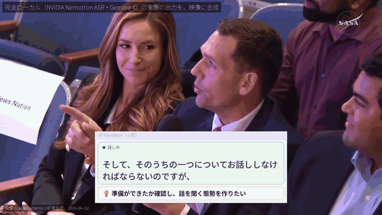
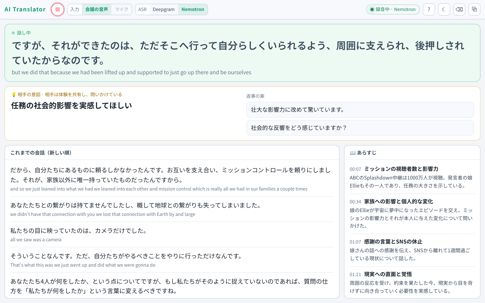
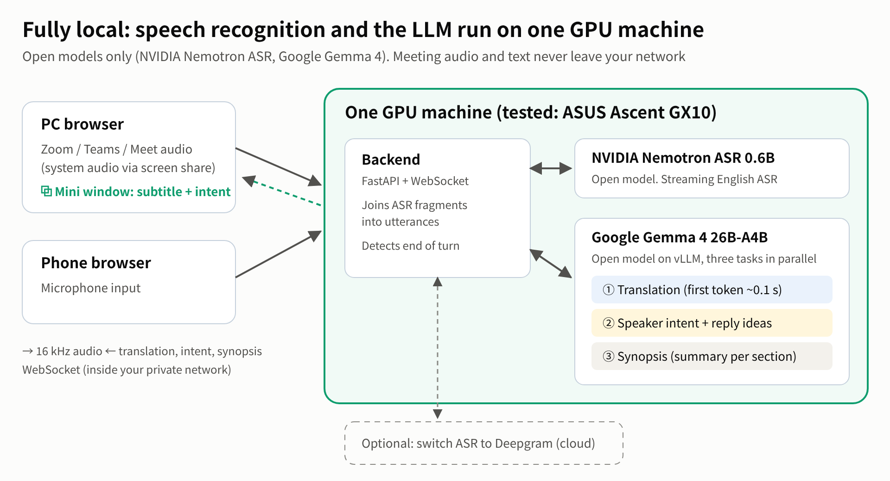

# AI Translator — fully local real-time meeting translation

Live subtitles for online meetings, English → Japanese or Japanese → English, plus the speaker's intent, reply ideas, and a running synopsis. **Speech recognition and the LLM both run on your own GPU machine.** No cloud API is required, and meeting audio and text never leave your network.

Built only on open models:

- **Speech recognition:** [NVIDIA Nemotron 3.5 ASR Streaming 0.6B](https://huggingface.co/nvidia/nemotron-3.5-asr-streaming-0.6b) (OpenMDW-1.1)
- **Translation, intent, synopsis:** [Google Gemma 4 26B-A4B](https://huggingface.co/google/gemma-4-26B-A4B-it) (Apache 2.0) on vLLM



*The always-on-top mini window translating a NASA press conference (Artemis II, 2026-04-16; NASA footage). The audio was streamed in real time through the local pipeline, and the actual output was overlaid on the video.*

**New in v2.1:** Japanese → English. Switch the direction with **EN→JA | JA→EN**; with JA→EN the subtitles, intent, reply ideas, synopsis, and UI are all in English. Still fully local: Nemotron transcribes Japanese too.

## Features

| Feature | What it does | Speed (measured) |
|---|---|---|
| **Real-time translation** | Translates the other speaker while they are still talking (English → Japanese or Japanese → English) | First token in ~0.1 s, full line in ~0.4 s |
| **Speaker intent + reply ideas** | When the other speaker finishes, shows their stance, what they want, and two replies you could give | ~2 s after they stop |
| **Synopsis** | Summarizes the conversation section by section | ~2 s per section |
| **Mini window** | One click opens an always-on-top window with just the subtitle and intent, over Zoom / Teams / Meet. Make it taller to see the history and synopsis | — |

- **Meeting audio on a PC:** captured as system audio through the browser's screen-share dialog (Chrome / Edge on Windows). Works with the desktop Zoom and Teams apps. Meeting apps do not play your own voice through the speakers, so only the other side is captured.
- **Phone:** microphone input.
- **ASR switch:** Nemotron (local) or Deepgram (cloud, optional), switchable during recording.



## Why fully local

| | Cloud APIs | This project |
|---|---|---|
| Meeting audio and content | Sent to an external server | Stays on your machine |
| Cost | Billed per minute or per token | Nothing per use |
| Latency | Round trip to a remote server | Word latency about half of Deepgram (0.29 s vs 0.64 s median) |
| Availability | Subject to pricing changes, rate limits, outages | Models are stored locally |
| Customization | Fixed models and settings | Prompts, chunking, and models are all yours to change |
| Setup | Accounts and API keys | None. Download the models once |

## Architecture



- The **browser** streams 16 kHz PCM over a WebSocket and receives translations, intents, and synopses.
- The **backend** (FastAPI) joins ASR fragments into utterances, detects the end of the other speaker's turn, and sends three kinds of requests to the same Gemma 4 model in parallel. vLLM batches them, so translation slows down by only tens of milliseconds.
- **Translation is plain text, not JSON.** With the translation inside a JSON object, the first translated token took ~2.3 s because the model had to write the other fields first. As plain text it takes ~0.1 s.
- **`asr_server/`** wraps Nemotron ASR in a Deepgram-compatible WebSocket protocol. Nemotron has no finality signal, so the server marks a segment final after 0.7 s without new words and sends `UtteranceEnd` after 1 s.

## Performance

Measured on one ASUS Ascent GX10 (NVIDIA GB10, 128 GB unified memory), November 2026.

| Metric | Result |
|---|---|
| Translation: first token / full line (LLM only) | ~0.1 s / ~0.4 s |
| Translation: ASR final → final translation (NASA press conference, 157 s, Nemotron) | median 0.74 s, p90 1.26 s |
| Intent: request → intent / two replies (LLM only) | ~0.6 s / ~1.6 s |
| ASR word latency, median (AMI meeting corpus) | Nemotron 0.29 s, Deepgram 0.64 s |
| ASR word error rate (AMI, fillers removed) | Nemotron 32.5%, Deepgram 27.8% |
| ASR word error rate (LibriSpeech) | Nemotron 6.7%, Deepgram 6.7–7.1% |
| GPU memory for Nemotron | ~2.6 GB per concurrent stream |

## Requirements

- An NVIDIA GPU machine that can serve **Gemma 4 26B-A4B (FP8)** with vLLM. The FP8 weights alone are about 26 GB, plus KV cache. Tested only on ASUS Ascent GX10 (aarch64, CUDA 13).
- Python 3.10+ for the backend, Python 3.12 for the ASR server, Node.js 18+ to build the frontend.
- Chrome or Edge on the PC (system audio capture and the mini window). The mini window uses Document Picture-in-Picture and is not available on phones.
- Optional: a Deepgram API key, only if you want to use Deepgram instead of Nemotron.

## Setup

The commands below assume the GPU machine also runs the backend. The backend can run elsewhere as long as it can reach the GPU machine.

### 1. Gemma 4 on vLLM (GPU machine)

```bash
docker run -d --gpus all --ipc host -p 8001:8000 --name vllm-gemma4 \
  vllm/vllm-openai:latest \
  RedHatAI/gemma-4-26B-A4B-it-FP8-Dynamic \
  --served-model-name gemma4-26b-a4b --max-model-len 32768 --gpu-memory-utilization 0.70
```

Use the vLLM image that matches your CUDA version and CPU architecture.

### 2. Nemotron ASR server (GPU machine)

```bash
python3.12 -m venv ~/venvs/nemotron-asr
~/venvs/nemotron-asr/bin/pip install torch --index-url https://download.pytorch.org/whl/cu130   # match your CUDA
~/venvs/nemotron-asr/bin/pip install "transformers>=5.13" numpy soundfile accelerate librosa websockets
~/venvs/nemotron-asr/bin/hf download nvidia/nemotron-3.5-asr-streaming-0.6b --include "*.json" model.safetensors

~/venvs/nemotron-asr/bin/python asr_server/asr_server.py --port 8092 --streams 2
```

`--streams` is the number of concurrent connections (one model instance each, ~2.6 GB of GPU memory per stream). Loading and warm-up take about 35 seconds.

### 3. Backend

```bash
cd backend
python3 -m venv .venv && .venv/bin/pip install -r requirements.txt
cp .env.example .env      # set GX10_HOST to the GPU machine's address (127.0.0.1 if it is this machine)
.venv/bin/uvicorn main:app --host 0.0.0.0 --port 8000
```

The `GX10_*` variable names come from the machine the project was built on. They work for any GPU machine:

| Variable | Default | Meaning |
|---|---|---|
| `GX10_HOST` | `localhost` | Address of the GPU machine |
| `GX10_BASE_URL` | `http://<GX10_HOST>:8001/v1` | vLLM OpenAI-compatible endpoint |
| `GX10_MODEL` | `gemma4-26b-a4b` | `--served-model-name` in vLLM |
| `NEMOTRON_ASR_URL` | `ws://<GX10_HOST>:8092/ws` | Nemotron ASR server |
| `DEEPGRAM_API_KEY` | — | Only if you use Deepgram |

### 4. Frontend

```bash
cd frontend
npm install
npm run build     # the backend serves frontend/dist
```

For development, run `npm run dev` and open `http://localhost:5173/#meeting`.

### 5. Open it

Open `http://<backend>:8000/#meeting`. Browsers allow microphone and screen-audio capture only on `localhost` or HTTPS, so use HTTPS when you open it from another device. We serve it inside a private network with `tailscale serve --https=10443 http://127.0.0.1:8000`. An always-on setup with systemd is in [`deploy/gx10/`](deploy/gx10/README.md) (Japanese).

## Usage

1. Choose the direction under **言語 / Lang**: **EN→JA** or **JA→EN** (not while recording). The UI follows the target language: Japanese for EN→JA, English for JA→EN.
1. Choose the input: **会議の音声 / Meeting audio** or **マイク / Mic**.
2. Choose the ASR: **Nemotron** (local) or **Deepgram** (cloud).
3. Press **●**. For meeting audio, pick **Entire screen** and turn on **Share system audio** in the browser dialog.
4. Press **⧉** to open the mini window. Drag it over your meeting app. Make it taller than 300 px to show the conversation history and synopsis tabs.

Nemotron is multilingual. Only English and Japanese are exposed in the UI; adding a language means adding it to the language maps in `backend/main.py` and `frontend/src/i18n.ts`.

## Limitations

- The intent is the model's inference from the conversation and can be wrong.
- Nemotron sometimes outputs nothing for English that does not sound native (seen with synthetic speech). Switch to Deepgram for speakers with strong accents.
- Proper nouns such as people's names are often misrecognized at the ASR stage.
- System audio capture works with Chrome / Edge on Windows. On macOS only a browser tab's audio can be captured. Phones use the microphone.
- Speed on CPU-only or smaller GPU machines has not been tested.

## Documentation

- Current spec (Japanese): [`docs/designs/meeting-assist-local.md`](docs/designs/meeting-assist-local.md)
- Design history, measurements, and fixes (Japanese): [`docs/designs/meeting-assist-local-history.md`](docs/designs/meeting-assist-local-history.md)

## Previous version (v1): Intent-First Translation

v1 was a cloud-based prototype that showed a speculative translation from the speaker's intent before the sentence was finished, using Deepgram and cloud LLMs (OpenAI, Gemini, Groq). It supported English, Japanese, Spanish, and Chinese in both directions, plus TTS. Its UI is still available at `/` (without `#meeting`). The v1 README and code are at tag [`v1.0.0`](https://github.com/matu79go/ai_translator/tree/v1.0.0).

## License

MIT. The models have their own licenses: Nemotron ASR (OpenMDW-1.1), Gemma 4 (Apache 2.0). This project is not affiliated with or endorsed by NVIDIA, Google, or NASA.
